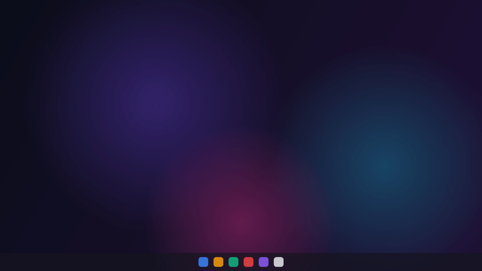
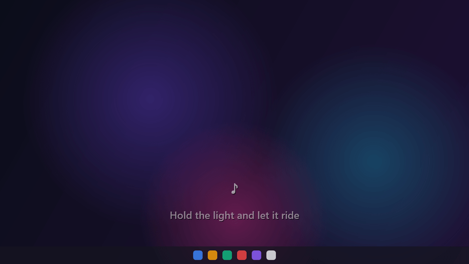
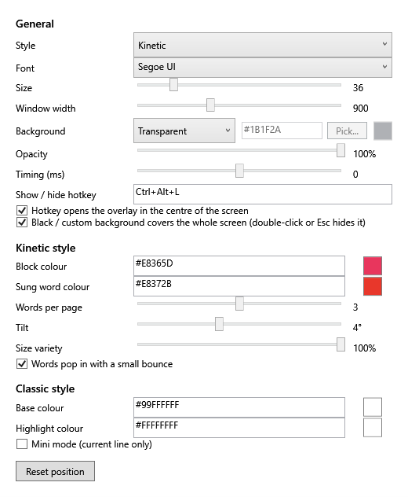

<h1 align="center">LyricFlow</h1>

<p align="center">
  Floating, word-by-word synced lyrics for whatever you're playing on Windows.
</p>

<p align="center">
  <a href="LICENSE"></a>
  
  
</p>

<p align="center">
  
</p>

LyricFlow sits in your system tray, notices the song playing in Spotify, YouTube Music, Apple Music or almost any other player, fetches time-synced lyrics for it, and draws them on top of your screen, one word at a time, in time with the music.

## Showcase

> The clips below are rendered by LyricFlow's own overlay code using original sample lyrics over a sample desktop background, so they show the real look and animation without any copyrighted lyrics.

### Kinetic style (the default, shown above)

One big word at a time, stacked and tilted, with the word being sung on a colour block that pops in. Words per page, tilt, size variety and pop-in are all adjustable.

### Classic style

The current line fills in word by word, with the next line dimmed underneath.

<p align="center">
  
</p>

### Full-screen mode

Set the background to Black or any colour and the lyrics fill the whole screen. Double-click or press `Esc` to hide it again.

<p align="center">
  
</p>

### Settings

<p align="center">
  
</p>

## Features

- **Works with your player.** Reads Windows' system media controls, so anything that shows up in the volume flyout works: Spotify, YouTube Music in a browser, Apple Music, VLC and more.
- **Two looks.** *Kinetic* (big stacked words on a colour block) and *Classic* (a line with a per-word fill).
- **Word-by-word timing.** Line timestamps come from the lyrics; each line's time is split across its words by length.
- **Floating overlay.** Transparent, always on top, click-through when locked, and draggable when you unlock it. Or go full-screen with a solid background.
- **Global hotkey.** `Ctrl+Alt+L` shows or hides the lyrics, opened on the screen your mouse is on. The hotkey is configurable.
- **Customisable.** Font, size, width, background, opacity, colours, timing offset, and for Kinetic: words per page, tilt, size variety and pop-in.
- **Fast on repeat.** Lyrics are cached on disk, so a song only needs the network once.
- **Lightweight.** A tray app with no concurrent GC thread and no telemetry.

## Install

1. Download the latest `LyricFlow-<version>-win-x64.zip` from the [Releases](../../releases) page.
2. Unzip it anywhere and run `LyricFlow.exe`. There's nothing to install, and you don't need .NET.
3. Windows may show *"Windows protected your PC"* because the app isn't code-signed. Click **More info**, then **Run anyway**.
4. Look for the music-note icon in the system tray (it may be under the `^` arrow), then play a song.

**Requirements:** Windows 10 (1809 or newer) or Windows 11, 64-bit.

## Usage

| Action | How |
| --- | --- |
| Show or hide lyrics | `Ctrl+Alt+L` |
| Open the menu | Right-click the tray icon: Show lyrics, Move overlay, Settings, Quit |
| Open Settings | Double-click the tray icon |
| Move the overlay | Tray menu → *Move overlay*, drag it, then untick to lock it |
| Full-screen lyrics | Settings → Background → Black or Custom |
| Hide full-screen lyrics | Double-click the screen or press `Esc` |

If the lyrics run a little early or late for a song, adjust **Timing (ms)** in Settings.

## Good to know

- Lyrics come from the free [LRCLIB](https://lrclib.net) service. You need an internet connection the first time a song plays, and not every song has lyrics.
- LyricFlow doesn't bundle or redistribute any lyrics. It fetches them on your behalf and caches them on your PC. Lyrics remain the property of their respective rights holders.
- The overlay can't draw over games in exclusive full-screen, or on the Windows lock screen.
- Only one copy runs at a time. Quit from the tray icon.
- Settings live in `%APPDATA%\LyricFlow` and the lyric cache in `%LOCALAPPDATA%\LyricFlow`. Delete those folders to reset everything.
- The only network traffic is requests to `lrclib.net` for the song you're playing.

## Build from source

You need the [.NET 8 SDK](https://dotnet.microsoft.com/download/dotnet/8.0) on Windows.

```powershell
git clone https://github.com/beadarshh/LyricFlow.git
cd LyricFlow

dotnet build
dotnet test
dotnet run --project src/LyricFlow
```

To produce the self-contained single-file `LyricFlow.exe` and a zip in `dist/`:

```powershell
powershell -ExecutionPolicy Bypass -File .\publish.ps1
```

### Project layout

```
src/LyricFlow/
  Media/      Windows media-session listener and playback clock
  Lyrics/     LRCLIB client, LRC parser, matcher, word timer, disk cache
  UI/         Overlay window, kinetic/classic renderer, settings, tray, hotkey
  Settings/   Settings model and JSON store
tests/LyricFlow.Tests/   Unit tests (parser, matcher, timing, cache, hotkeys, ...)
```

## Contributing

Issues and pull requests are welcome. For anything larger than a small fix, please open an issue first so we can talk it through. Run `dotnet test` before sending a PR.

## Acknowledgements

- [LRCLIB](https://lrclib.net) for the free, open synced-lyrics database.

## License

LyricFlow is released under the [MIT License](LICENSE). © 2026 Adarsh Pandey.
